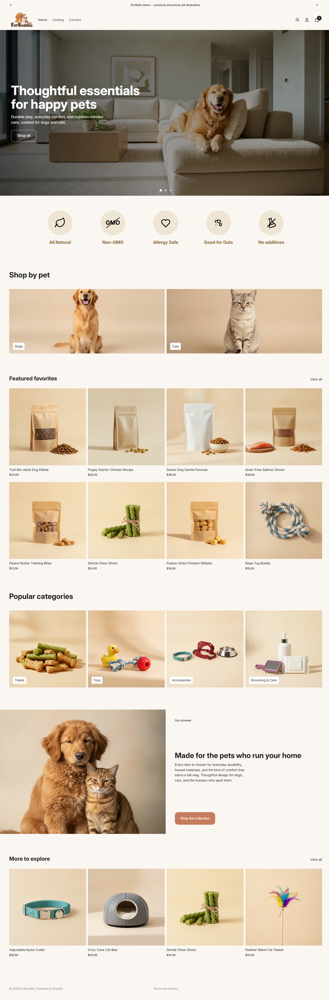
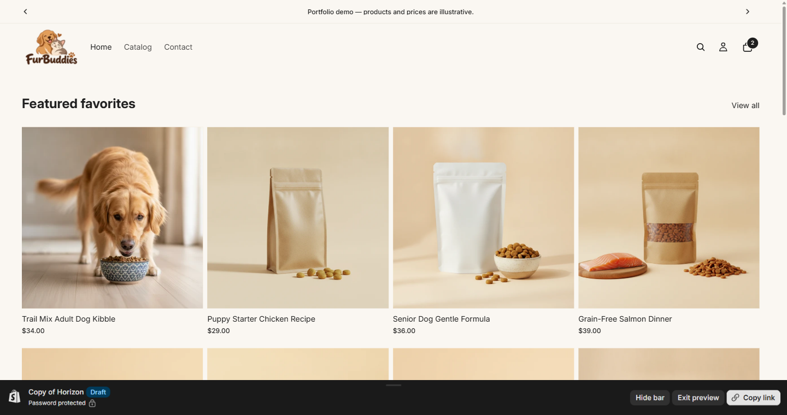
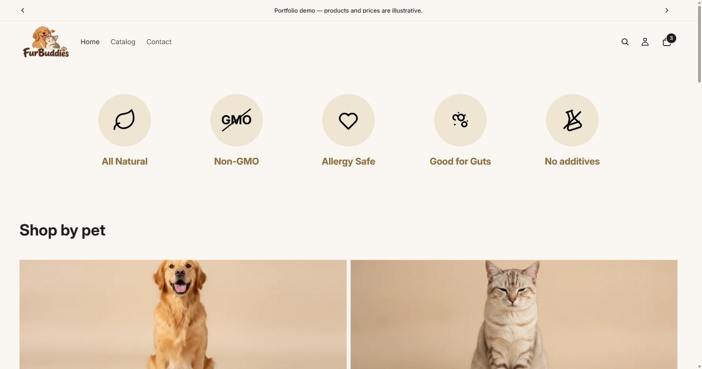
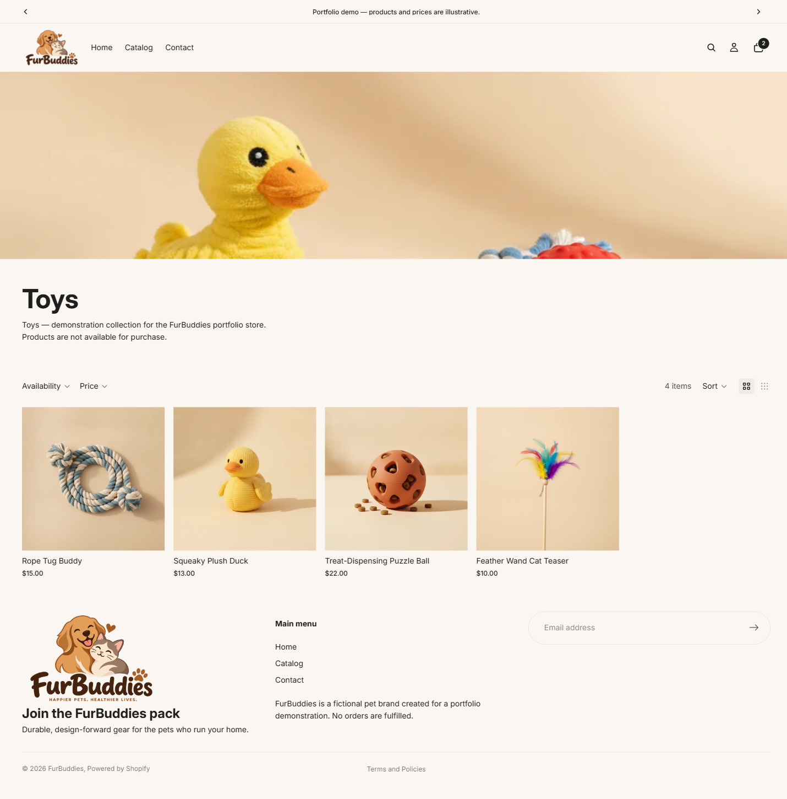
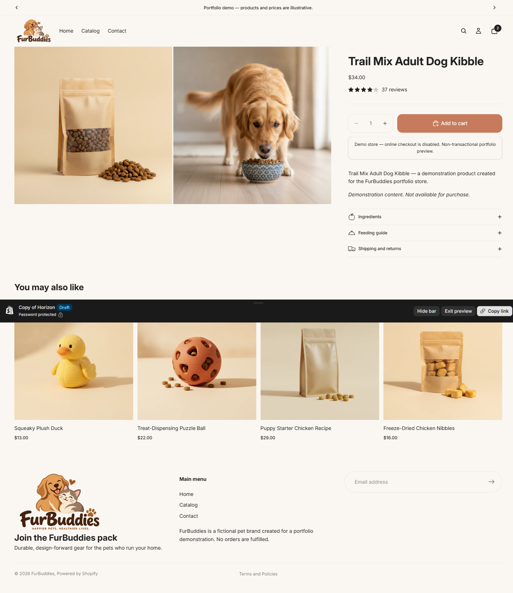

# FurBuddies — Shopify Pet Supplies Store

A **portfolio-only** Shopify storefront demo built on **Online Store 2.0** (Horizon theme base). FurBuddies is a fictional pet-supplies shop created to demonstrate Shopify theme design and storefront UX. There are **no real products, customers, orders, or payments** — all copy, prices, reviews, and policies are illustrative.

**Live demo:** https://pet-pantry-test.myshopify.com/ — *password-protected; ask me for access.*
**Checkout is intentionally disabled.**



---

## Highlights

- **Custom cross-fade hero** (`sections/fb-hero.liquid`) — 3 full-bleed slides with a 0.9s cross-fade, 3.5s autoplay, and dot navigation only (no arrows, no play/pause). It pauses while the tab is hidden and fully honours `prefers-reduced-motion`.
- **Benefits / trust bar** (`sections/fb-benefits.liquid`) — 5 icon badges with labels on a cream band; responsive 5 → 3 → 2 columns, with merchant-editable colours.
- **Fade-on-hover product cards** — hovering a card cross-fades its second (lifestyle) image over the main image (0.4s), replacing the theme's default slide/zoom hover.
- **Collection banner + filters/sort** (`sections/fb-collection-banner.liquid`) — a wide banner plus product filtering and sorting.
- **Product page** — review-star metafields, a key-details accordion (Ingredients / Feeding guide / Shipping & returns), and related products.
- **Rotating announcement bar**, custom logo + favicon, and a responsive layout throughout.
- **Demo cart** — add / update quantity / remove, with checkout disabled and a clear demo notice.

| Product card hover (fade) | Benefits bar |
| --- | --- |
|  |  |

## Catalog

- **24 demo products** across six categories: dog food, cat food, treats, toys, accessories, grooming.
- **8 custom collections**: `dogs`, `cats`, `dog-food`, `cat-food`, `treats`, `toys`, `accessories`, `grooming`.
- **AI-generated imagery** — one product shot and one "pet using/eating the product" lifestyle image per product (the lifestyle image is the hover image).
- **Fictional rating metafields** (`reviews.rating`, `reviews.rating_count`) drive the review stars.

| Collection | Product page |
| --- | --- |
|  |  |

## Design system

- Background `#faf7f2`, foreground `#1f1f1f`, muted `#5a5a5a`, surface `#e8e3db`, terracotta accent `#c67b5c`.
- Corner radii: global 14, product images 14, cards 10.
- Typography: **Inter** (headings + body), with tuned letter-spacing and text wrapping.

## Accessibility

- All interactive elements are keyboard-reachable with visible focus.
- **Reduced motion** disables the hero autoplay (JS) and the announcement bar rotation, and shortens the card-hover transition.
- Hidden hero slides are marked `inert` (no focusable content in hidden slides).
- The star rating uses `role="img"` with an accessible label; loading placeholders use a single `role="status"` region.
- Benefits-bar label contrast was raised to **4.68:1** (WCAG AA).

## Commerce safeguards

- Accelerated checkout is replaced with a demo notice; the cart's checkout button is **disabled** with a "Checkout disabled (demo)" label.
- The `show_accelerated_checkout_buttons` setting is off.
- **0 orders** — the store cannot accept payments.

## Tech stack

**Shopify** (Online Store 2.0) · **Liquid** · **JavaScript** · **HTML/CSS** · Responsive design.
Theme base: Horizon 4.3.0.

## Repository layout

```
theme-snapshot/   theme files — custom sections/snippets plus a snapshot of the base theme files used
  sections/         fb-hero, fb-benefits, fb-collection-banner (+ base sections)
  blocks/           theme blocks (e.g. review, product-recommendations)
  templates/        JSON templates (index, product, collection, page.contact)
  config/           settings schema + data
docs/             audit reports, portfolio write-up, image credits, screenshots
scripts/          automation/tooling used to build and audit the demo
PROJECT.md        chronological build log
README.md         this file
```

## How it was built

The theme was assembled and iterated programmatically and then verified in the browser:

- `scripts/` contains the tooling used to read/write theme files, upload images, and run audits.
- QA used a real browser (Playwright), plus **axe-core** for accessibility checks.
- The build log in `PROJECT.md` records each phase (audit → design → catalog → safeguards → QA → polish → final audit).

## Notes & disclaimers

- Fictional "FurBuddies" brand; all content is illustrative and not a real business.
- Product and lifestyle imagery is AI-generated for the demo.
- Checkout and payments are disabled, and the storefront is password-protected (Shopify development stores are permanently gated).
- The repository contains no secrets or credentials.
- Not affiliated with any real brand or business.
